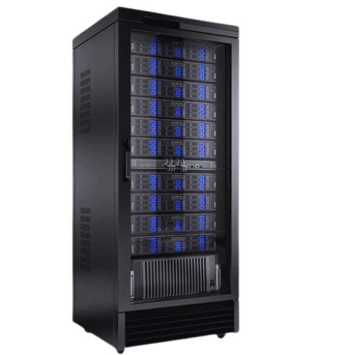

# Local AI Server Studio

<div align="center">
  
  <p><em>Guida minimale e dispensario tecnico per trasformare un calcolatore personale in un server AI locale privato.</em></p>
</div>

---

## 📋 Requisiti Hardware Minimi e Consigliati

1. **VRAM (Memoria della scheda video)**: È il fattore più critico. Il modello AI deve poter essere caricato (totalmente o in gran parte) nella VRAM della GPU.
   - **Base (modelli da 3B a 8B)**: Almeno **8 GB di VRAM** (es. NVIDIA RTX 3060/4060 o equivalenti).
   - **Intermedio/Avanzato (modelli da 30B a 70B+)**: Richiede **32 GB, 64 GB o più** (spesso ottenuti con GPU multiple come doppie RTX 3090/4090 o sistemi unificati ad alta memoria RAM come i chip Apple Silicon o piattaforme AMD Ryzen AI Max).
2. **RAM di sistema**: Almeno **16 GB** (consigliati **32 GB o 64+ GB** se usi modelli pesanti o memoria condivisa).
3. **Storage**: Unità **SSD NVMe veloce**, poiché i file dei modelli AI pesano da pochi gigabyte fino a decine di gigabyte.

---

## 🛠️ Funzionalità dell'Applicazione

- **1. Requisiti Hardware & Check**: Audit interattivo della compatibilità del tuo PC con calcolo di VRAM, RAM, storage e token/s stimati.
- **2. Configura Server (1-Click)**: Generatore automatico di script per Ollama, llama.cpp, vLLM e Docker per Windows PowerShell, macOS e Linux.
- **3. Catalogo Modelli**: Raccolta modelli compatibili (Llama 3.2 3B, Llama 3.1 8B, DeepSeek R1 8B/14B/70B, Qwen 2.5 Coder, Mistral NeMo).
- **4. Banco di Prova (Test API)**: Console di collaudo streaming con OpenAI API standard (/v1/chat/completions) e snippet cURL, Python e Node.js.
- **5. Accesso LAN & Smartphone**: Configurazione firewall Windows/Linux e collegamento per client mobile (Chatbox, Enchanted), web (Open WebUI) ed editor (Continue.dev).
- **Calcolatore VRAM**: Formula matematica per pesi di quantizzazione e KV-cache del contesto.
- **Glossario Tecnico**: Guida tipografica ai termini chiave (Quantizzazione, Finestre di Contesto, VRAM, Cache KV, GGUF, Ollama, ecc.).

---

## 🚀 Avvio Locale

```bash
npm install
npm run dev
```

Apri `http://localhost:3000` nel browser.
